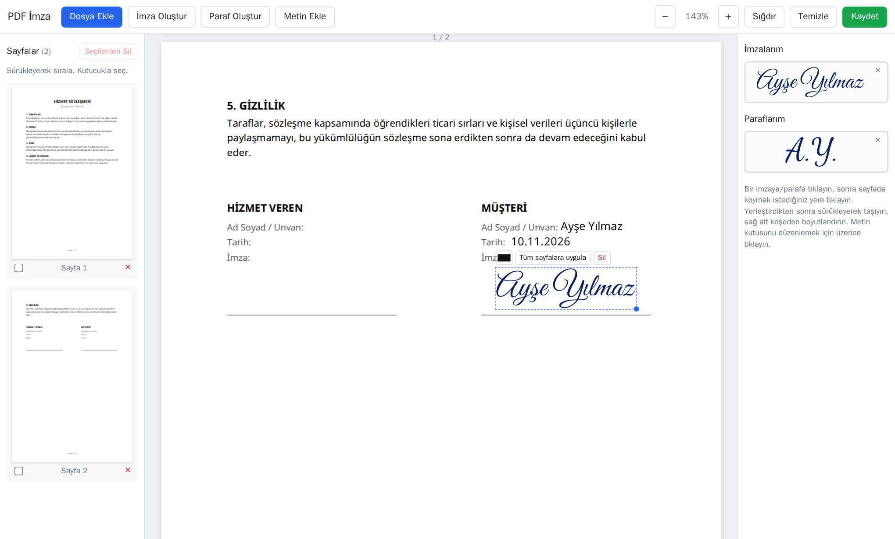
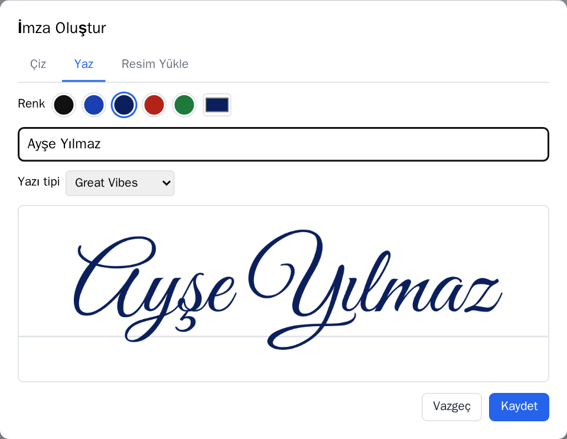
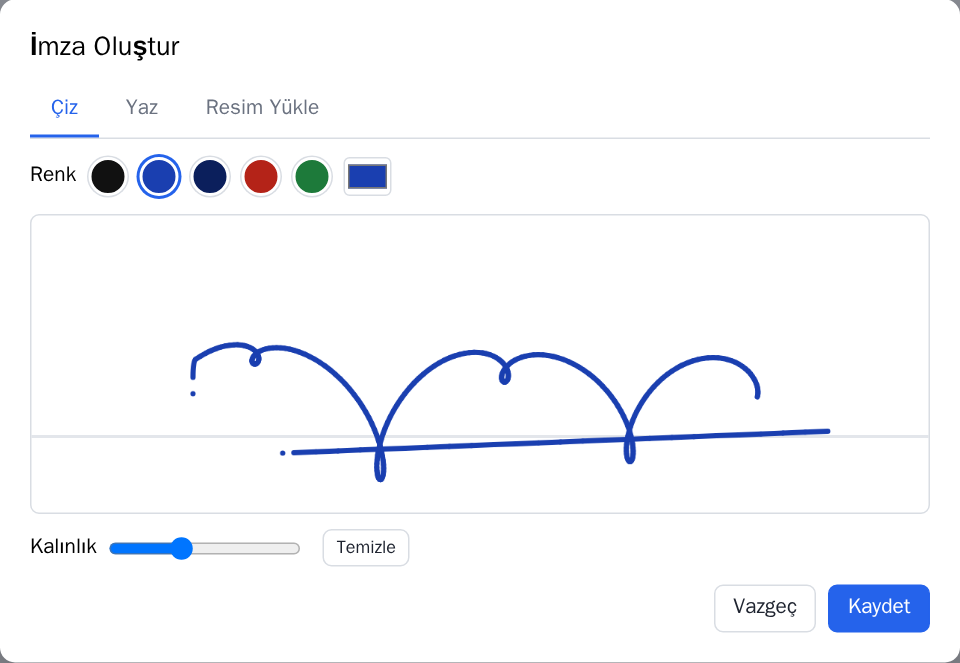
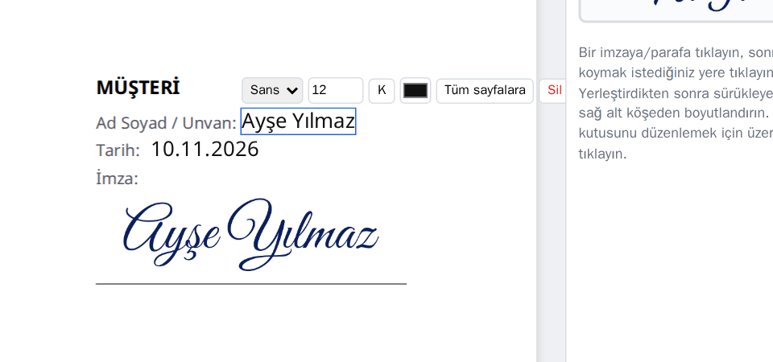
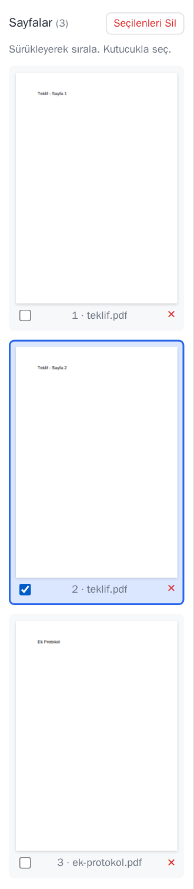
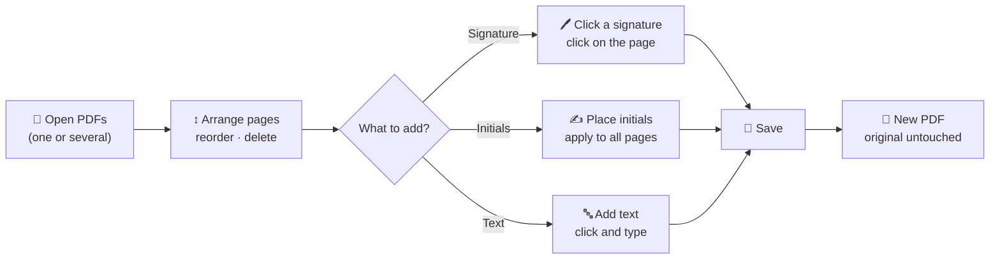
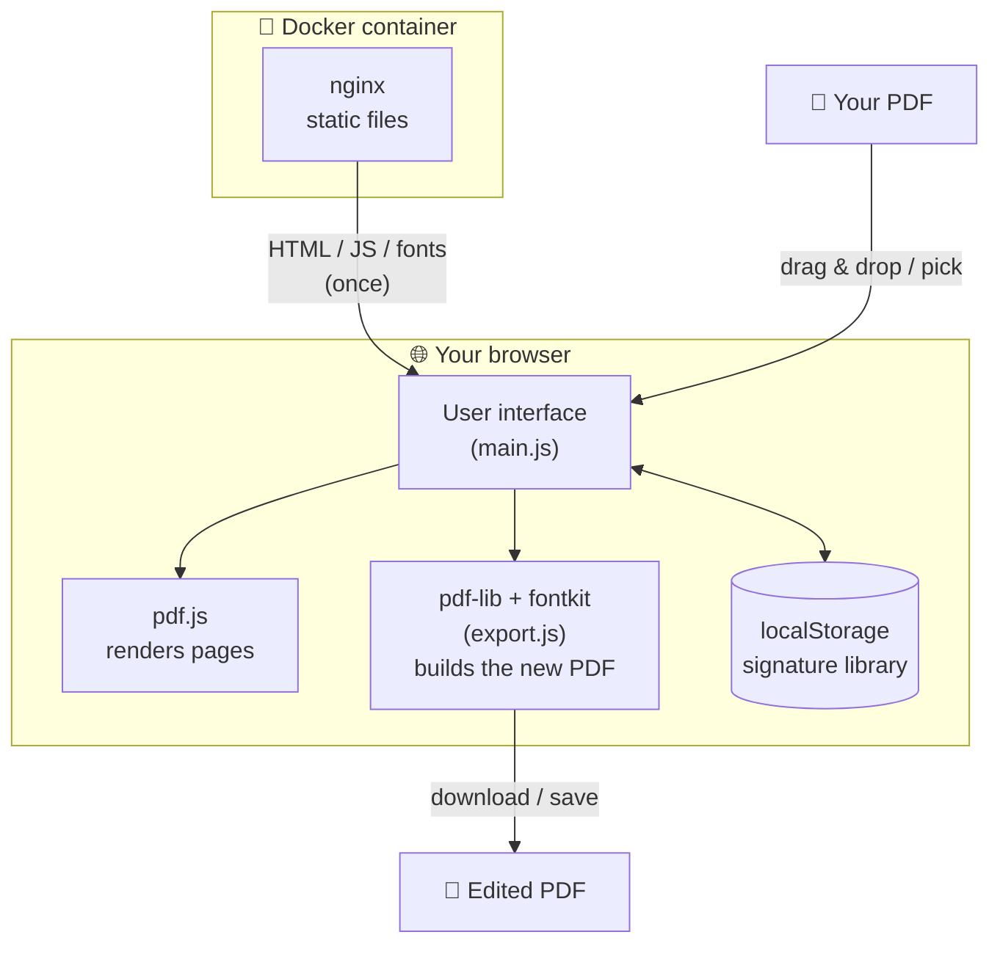
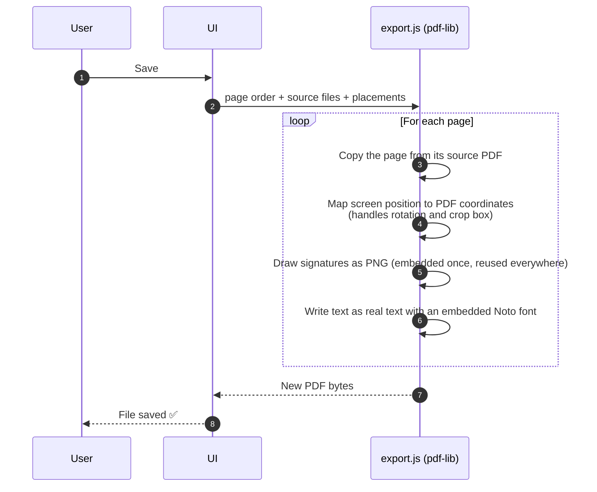
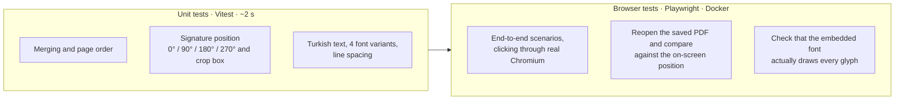

<div align="center">

# ✍️ PDF Signer

**Sign, initial, merge and edit your PDFs — entirely in your browser, for free.**

A lightweight, open-source and privacy-friendly alternative to the Adobe Acrobat features people use every day.

[](https://github.com/talhaymn7/pdfSigner/actions/workflows/ci.yml)
[](LICENSE)




</div>

> 🇹🇷 The user interface is in Turkish. Button names are given below in Turkish with their English meaning.

---

## ✨ Features

| | Feature | Description |
|---|---|---|
| 🖊️ | **Signatures & initials** | Draw with a mouse or pen, type your name in a handwriting font, or upload a photo of your signature (the white background is removed automatically). |
| 🎨 | **Color & stroke width** | Preset colors (black, blue, navy, red, green) or any custom color. You can recolor a signature even after placing it. |
| 📍 | **Place anywhere** | Click to place, drag to move, resize from the corner. Copy your initials to **every page** in one click. |
| 🔤 | **Text boxes** | Names, dates, notes… Pick the font, size, bold and color. Saved as real, **selectable and searchable** text, with full Turkish character support (ş, ğ, ı, İ, ₺). |
| 📚 | **Merge** | Open several PDFs at once; they are combined into a single document. |
| ↕️ | **Page management** | Drag thumbnails to reorder, delete pages one by one or in bulk. |
| 💾 | **Safe saving** | Always writes a new file; your originals are never modified. |
| 🔒 | **Privacy** | Nothing is uploaded anywhere. All processing happens in your browser. |

## 📸 Screenshots

<table>
  <tr>
    <td width="50%"><br/><sub><b>Typed signature</b> — handwriting fonts, color picker</sub></td>
    <td width="50%"><br/><sub><b>Drawn signature</b> — stroke width and color</sub></td>
  </tr>
  <tr>
    <td><br/><sub><b>Text box</b> — font, size, bold, color, apply to all pages</sub></td>
    <td align="center"><br/><sub><b>Merging</b> — each page shows which file it came from</sub></td>
  </tr>
</table>

## 🧭 How It Works



### Architecture

The app runs entirely on the client. Docker is just a small nginx serving the built static files; your PDFs never reach a server.



### What happens when you save?



## 🚀 Quick Start

The only requirement is [Docker](https://www.docker.com/products/docker-desktop/).

```bash
git clone https://github.com/talhaymn7/pdfSigner.git
cd pdfSigner
docker compose up -d --build
```

Open **http://localhost:8080** in your browser.

To stop it: `docker compose down`

> 💡 To use a different port, change `"8080:80"` in `docker-compose.yml`.

## 📖 Usage

1. Open a PDF with **Dosya Ekle** *(Add File)* or drag files onto the window. Multiple files are merged in order.
2. **İmza Oluştur** / **Paraf Oluştur** *(Create Signature / Create Initials)*: pick the *Çiz* *(Draw)*, *Yaz* *(Type)* or *Resim Yükle* *(Upload Image)* tab, choose a color and press **Kaydet** *(Save)*. The signature is added to your library and is still there next time.
3. Click a signature in the right panel, then click where you want it on the page.
   - Drag to move, use the handle in the bottom-right corner to resize.
   - Use the toolbar above it to **change the color**, **Tüm sayfalara uygula** *(Apply to all pages)* or **Sil** *(Delete)*.
4. **Metin Ekle** *(Add Text)* → click on the page → type (Enter for a new line). Click to edit, drag to move.
5. In the left panel, drag pages to reorder; delete with **×**, or tick several and use **Seçilenleri Sil** *(Delete Selected)*.
6. **Kaydet** *(Save)*. Your original files stay unchanged.

| Shortcut | Action |
|---|---|
| `Delete` / `Backspace` | Delete the selected signature/text |
| `Esc` | Cancel placement · finish editing text |

## 🧪 Tests

The project has two test layers. Everything, including the browser tests, runs in containers; nothing is installed on your system.



```bash
npm ci            # dependencies are installed into the project folder only
npm test          # unit tests
npm run test:e2e  # browser tests (Docker)
```

| Layer | What it verifies |
|---|---|
| **Unit** (`tests/unit`) | Files merge in the chosen order, deleted pages are dropped, signatures land exactly in place at every rotation and on cropped pages, Turkish text is searchable, and a signature used on many pages is embedded only once. |
| **Browser** (`tests/e2e`) | Open, merge, drag to reorder, delete, draw and move a signature, copy initials to all pages, type on a rotated page, style text, save. Then check the saved PDF: is every item where it appeared on screen, and does the text render with all its glyphs? |

[GitHub Actions](.github/workflows/ci.yml) runs both layers on every push. The README screenshots are produced by the same setup: `npm run screenshots`.

## 🗂️ Project Structure

```
├── index.html                 UI skeleton
├── src/
│   ├── main.js                UI: viewer, page panel, placement, signature dialog
│   ├── export.js              PDF output: merging, embedding signatures and text
│   ├── style.css
│   └── fonts/                 Text box fonts (Noto, Latin + Turkish subset)
├── scripts/
│   ├── copy-pdfjs.mjs         Copies pdf.js fonts/cmaps/wasm into the build
│   └── subset-fonts.py        Cuts down the Noto fonts (fontTools)
├── tests/
│   ├── unit/                  Vitest unit tests
│   └── e2e/                   Playwright tests, test PDFs, screenshot script
├── Dockerfile                 Multi-stage build → nginx
├── docker-compose.yml         The app
└── docker-compose.test.yml    App + browser tests
```

## 🛠️ Development

To work without Docker, with live reload (Node.js 22+):

```bash
npm ci
npm run dev
```

Dependencies are installed into the project only (`node_modules`), and the npm cache lives in the project too (`.npm-cache`).

To change the character set of the text box fonts (using a project-local Python virtual environment):

```bash
python -m venv .venv
.venv/Scripts/pip install fonttools        # macOS/Linux: .venv/bin/pip
.venv/Scripts/python scripts/subset-fonts.py
```

**Built with:** [pdf.js](https://mozilla.github.io/pdf.js/) (rendering) · [pdf-lib](https://pdf-lib.js.org/) + fontkit (PDF output) · [Vite](https://vite.dev/) · [Vitest](https://vitest.dev/) · [Playwright](https://playwright.dev/) · nginx · Docker

## ⚠️ Good to Know

- **Signature type:** The signature here is an image of a handwritten signature. It is **not** a qualified electronic signature (e-signature) and does not replace one where one is legally required.
- **The signature library** is stored in your browser's local storage (per browser and address). If you switch browsers or ports, you will need to create your signatures again.
- **The save dialog** (choosing a location) works in Chrome/Edge on `localhost`; otherwise the file is downloaded directly.
- **Encrypted PDFs** are not supported.
- **Text box characters:** Latin script, Turkish and common symbols (₺ € – “ ” …). Other characters (e.g. emoji, Cyrillic) won't appear in the PDF.

## 📄 License

[Apache License 2.0](LICENSE). The text box fonts (Noto Sans / Noto Serif) are licensed under the [SIL Open Font License 1.1](src/fonts/OFL.txt).
